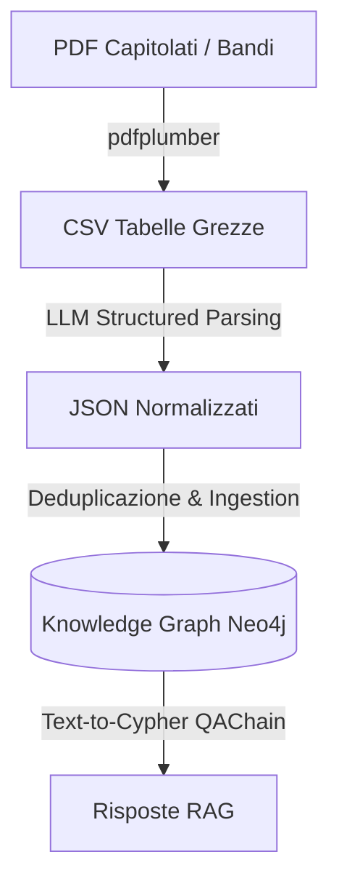

# Tables Extraction & GraphRAG Pipeline

Questo sistema fornisce una pipeline end-to-end in Python per estrarre tabelle complesse e sfalsate da capitolati e bandi di gara d'appalto in ambito medico (in formato PDF), normalizzarle semanticamente tramite Modelli di Linguaggio (LLM) basati su schemi Pydantic, integrarle in un database a grafi Neo4j ed infine interrogarle tramite tecniche avanzate di GraphRAG.

---

## Architettura del Sistema

Il flusso dati si sviluppa attraverso questi passaggi fondamentali:



---

## Struttura del Progetto

La repository è organizzata secondo un layout pulito e modulare:

*   **`data/`**: Raccolta di tutti i file di input, intermedi, dump ed output log.
    *   `pdf/`: File PDF sorgente dei capitolati di gara (`capitolati/` e `criteri/`).
    *   `extractions/`: Tabelle intermedie estratte in formato CSV.
    *   `json_normalized/`: Output JSON formattati dagli LLM secondo lo schema tipizzato.
    *   `ground_truth/`: File di test annotati manualmente per validare l'accuratezza.
    *   `benchmarks/`: File di benchmark RAG (es. `GraphRAG.jsonl`).
    *   `evaluation_reports/`: Report aggregati e individuali dei risultati dei benchmark.

*   **`src/`**: Codice sorgente strutturato in package logici.
    *   `extraction/`: Moduli per il caricamento, estrazione e parsing strutturato delle tabelle.
    *   `table2graph/`: Ontologia, vincoli e caricamento massivo transazionale sul database a grafi.
    *   `evaluation/`: Per validare la precisione delle estrazioni e la QAChain del RAG.

---

## Pipeline di Elaborazione e Comandi

La pipeline si esegue in quattro passaggi sequenziali ordinati:

### Step 1: Estrazione Tabelle (PDF ➔ CSV)
Estrae le matrici di tabelle grezze dai documenti PDF archiviati in `data/pdf/`.

*   **Algoritmo Euristico Avanzato (pdfplumber)**: Applica euristiche di unione righe multi-linea, allineamento di colonne sfalsate per celle unite, rimozione di righe consecutive duplicate, e divisione post-riepiloghi (totale/IVA).
    ```bash
    python src/extraction/plumber.py
    ```

### Step 2: Normalizzazione Semantica tramite LLM (CSV ➔ JSON)
Invia i file CSV precedentemente estratti a OpenAI utilizzando le API Structured Outputs. Lo script mappa in modo sicuro i dati grezzi su schemi Pydantic (`ElementoTabella`, `Criterio`, `TabellaNormalizzata`) standardizzando valute, scompattando range di lotti (es: *"da 1 a 4"* ➔ `["1", "2", "3", "4"]`) ed isolando sublotti.
```bash
python src/extraction/llm_extractor.py
```
*(Durante l'esecuzione, lo script offre una preview interattiva per decidere se processare o saltare ciascuna tabella)*

### Step 3: Costruzione del Knowledge Graph (JSON ➔ Graph)
Raggruppa le tabelle normalizzate, risolve le ridondanze informative tramite aggregazione in memoria ("broadcasting" di dati generici a sublotti specifici) ed esegue query Cypher ottimizzate in batch per popolare Neo4j.
```bash
python src/table2graph/json2graph.py
```

### Step 4: Aggiunta dei Vincoli di Integrità (Constraints)
Accedi a Neo4j Browser ed applica i vincoli di univocità descritti in [src/table2graph/schema.py](file:///Users/antonio/Desktop/uni/magistrale/semantics/progetto/tables-extraction/src/table2graph/schema.py) per velocizzare le query ed evitare duplicati durante import multipli:
```cypher
CREATE CONSTRAINT FOR (d:DocumentoGara) REQUIRE d.id IS UNIQUE;
CREATE CONSTRAINT FOR (l:Lotto) REQUIRE (l.doc_id, l.id_lotto) IS UNIQUE;
CREATE CONSTRAINT FOR (s:SubLotto) REQUIRE (s.doc_id, s.id_lotto, s.sub_lotto) IS UNIQUE;
CREATE CONSTRAINT FOR (c:CIG) REQUIRE c.codice IS UNIQUE;
CREATE CONSTRAINT FOR (cn:CND) REQUIRE cn.codice IS UNIQUE;
CREATE CONSTRAINT FOR (cr:Criterio) REQUIRE cr.parametro IS UNIQUE;
```

---

## Suite di Valutazione e Benchmark

La repository include script dedicati a misurare le performance qualitative dell'intero processo:

### 1. Valutatore delle Estrazioni
Confronta le tabelle estratte ed il parsing gerarchico delle entità (Lotti e Sublotti) contro una ground truth annotata manualmente situata in `data/ground_truth/`. Misura parametri quali la frammentazione delle tabelle, l'allineamento degli header e il lot/sublot recall.
```bash
python src/evaluation/extraction_evaluator.py
```
*I report di performance sono consultabili all'interno di `data/evaluation_reports/GLOBAL_SUMMARY_REPORT.json`.*

### 2. RAG Benchmark
Invia un set di domande strutturate e complesse in italiano (definite in `data/benchmarks/GraphRAG.jsonl`) ad una catena `GraphCypherQAChain` che traduce la richiesta in query Cypher (Text-to-Cypher) ed elabora la risposta.
```bash
python src/evaluation/test_rag.py
```
*Le risposte generate e i log di accuratezza vengono salvati in `data/evaluation_reports/rag_results.json`.*

