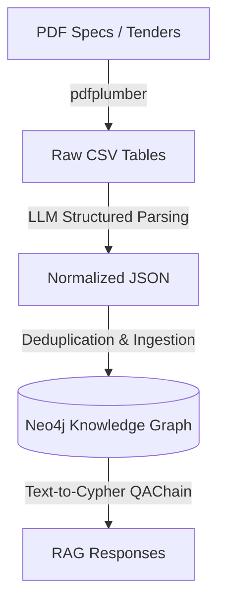

# Tables Extraction & GraphRAG Pipeline

This system provides an end-to-end Python pipeline to extract complex and staggered tables from medical technical specifications and tender documents (in PDF format), semantically normalize them using Language Models (LLMs) based on Pydantic schemas, integrate them into a Neo4j graph database, and finally query them using advanced GraphRAG techniques.

---

## System Architecture

The data flow progresses through the following key steps:



---

## Project Structure

The repository is organized in a clean and modular layout:

*   **`data/`**: Collection of all input, intermediate, dump, and output log files.
    *   `pdf/`: Source PDF files of tender specifications (`capitolati/` and `criteri/`).
    *   `extractions/`: Intermediate tables extracted in CSV format.
    *   `json_normalized/`: Output JSON files formatted by LLMs according to the typed schema.
    *   `ground_truth/`: Test files annotated manually to validate accuracy.
    *   `benchmarks/`: RAG benchmark files (e.g., `GraphRAG.jsonl`).
    *   `evaluation_reports/`: Aggregated and individual reports of benchmark results.

*   **`src/`**: Source code structured into logical packages.
    *   `extraction/`: Modules for loading, extracting, and structured parsing of tables.
    *   `table2graph/`: Ontology, constraints, and bulk transactional loading to the graph database.
    *   `evaluation/`: Modules to validate extraction accuracy and the RAG QAChain.

---

## Processing Pipeline and Commands

The pipeline is executed in four sequential steps:

### Step 1: Table Extraction (PDF ➔ CSV)
Extracts raw table matrices from the PDF documents stored in `data/pdf/`.

*   **Advanced Heuristic Algorithm (pdfplumber)**: Applies heuristics for multi-line row merging, alignment of staggered columns for merged cells, removal of consecutive duplicate rows, and splitting post-summaries (total/VAT).
    ```bash
    python src/extraction/plumber.py
    ```

### Step 2: Semantic Normalization via LLM (CSV ➔ JSON)
Sends the previously extracted CSV files to OpenAI using the Structured Outputs API. The script safely maps raw data onto Pydantic schemas (`ElementoTabella`, `Criterio`, `TabellaNormalizzata`), standardizing currencies, unpacking lot ranges (e.g., *"from 1 to 4"* ➔ `["1", "2", "3", "4"]`), and isolating sub-lots.
```bash
python src/extraction/llm_extractor.py
```
*(During execution, the script offers an interactive preview to decide whether to process or skip each table)*

### Step 3: Knowledge Graph Construction (JSON ➔ Graph)
Groups normalized tables, resolves information redundancies via in-memory aggregation (broadcasting generic data to specific sub-lots), and executes optimized batch Cypher queries to populate Neo4j.
```bash
python src/table2graph/json2graph.py
```

### Step 4: Adding Integrity Constraints
Access the Neo4j Browser and apply the uniqueness constraints described in [src/table2graph/schema.py](file:///Users/antonio/Desktop/uni/magistrale/semantics/progetto/tables-extraction/src/table2graph/schema.py) to speed up queries and avoid duplicates during multiple imports:
```cypher
CREATE CONSTRAINT FOR (d:DocumentoGara) REQUIRE d.id IS UNIQUE;
CREATE CONSTRAINT FOR (l:Lotto) REQUIRE (l.doc_id, l.id_lotto) IS UNIQUE;
CREATE CONSTRAINT FOR (s:SubLotto) REQUIRE (s.doc_id, s.id_lotto, s.sub_lotto) IS UNIQUE;
CREATE CONSTRAINT FOR (c:CIG) REQUIRE c.codice IS UNIQUE;
CREATE CONSTRAINT FOR (cn:CND) REQUIRE cn.codice IS UNIQUE;
CREATE CONSTRAINT FOR (cr:Criterio) REQUIRE cr.parametro IS UNIQUE;
```

---

## Evaluation Suite and Benchmark

The repository includes dedicated scripts to measure the qualitative performance of the entire process:

### 1. Extraction Evaluator
Compares extracted tables and the hierarchical parsing of entities (Lots and Sub-lots) against a manually annotated ground truth located in `data/ground_truth/`. It measures metrics such as table fragmentation, header alignment, and lot/sub-lot recall.
```bash
python src/evaluation/extraction_evaluator.py
```
*Performance reports are available in `data/evaluation_reports/GLOBAL_SUMMARY_REPORT.json`.*

### 2. RAG Benchmark
Sends a set of complex, structured questions in Italian (defined in `data/benchmarks/GraphRAG.jsonl`) to a `GraphCypherQAChain` that translates the request into a Cypher query (Text-to-Cypher) and processes the response.
```bash
python src/evaluation/test_rag.py
```
*Generated responses and accuracy logs are saved in `data/evaluation_reports/rag_results.json`.*
