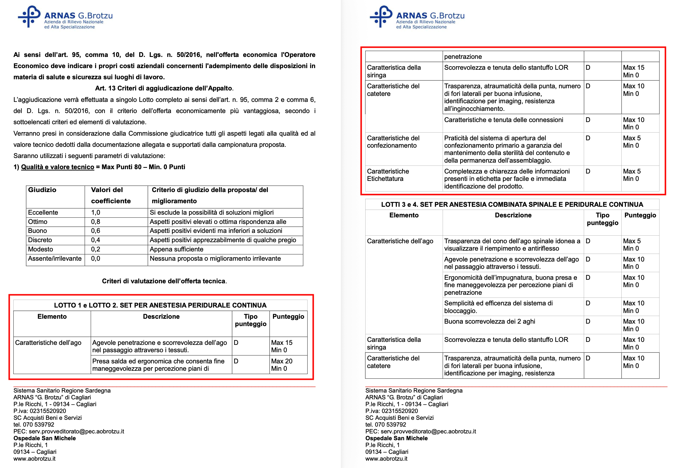
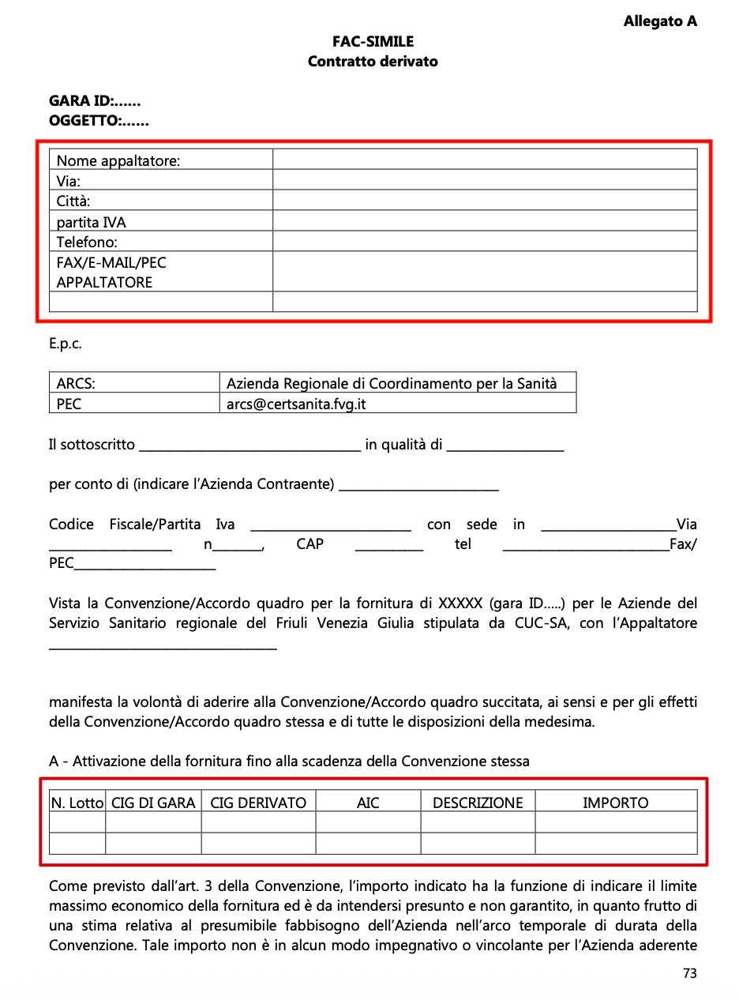
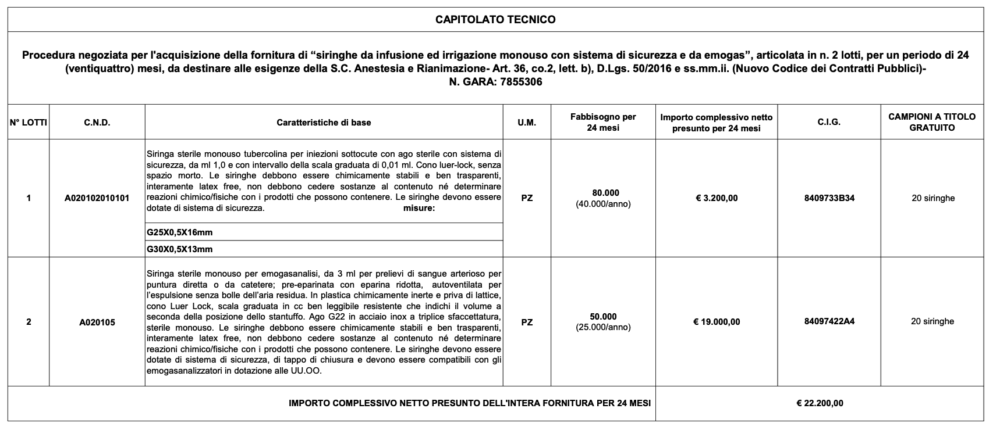
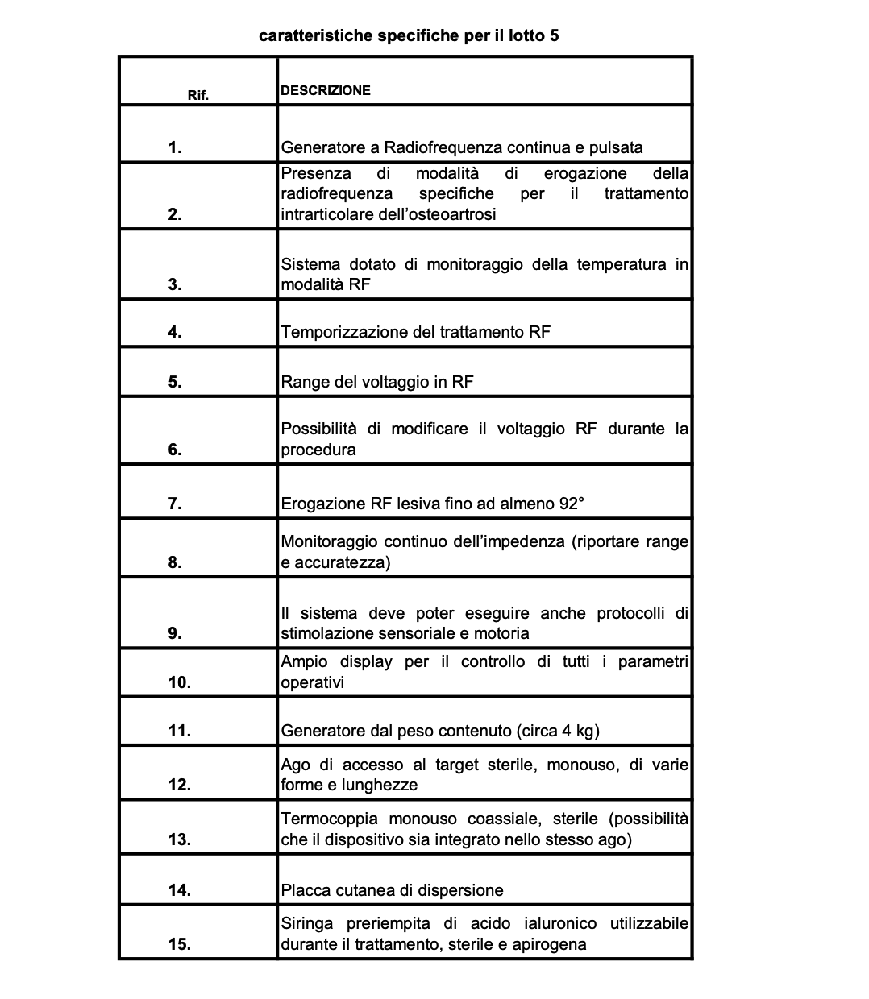

# Report di Valutazione dell'Estrazione Tabellare: Custom Pipeline vs Baseline

## Riepilogo metrico globale (5 documenti di test)

| Metrica di Valutazione | Baseline (Docling) | Custom Pipeline (pdfplumber) |
|---|---:|---:|
| Tabelle Logiche Attese | 30 | 30 |
| Frammentazione (Extra Fragments) | 15 | 0 |
| Header Alignment Score | 34.6% (47/136) | 94.9% (129/136) |
| Lot Recall | 100.0% (67/67) | 100.0% (67/67) |
| Sublot Hierarchy Score | 4.7% (9/192) | 100.0% (192/192) |

---

## 1. Frammentazione zero e integrità di contesto

L'euristica che unisce tabelle a cavallo di più pagine annulla la frammentazione (0 frammenti extra vs 15 della baseline). Mantenere un'unica tabella logica evita la perdita delle intestazioni e previene righe orfane di contesto o di intestazione.

Esempio (documento: *capitolato speciale.pdf*, Tabella Lotti 1 e 2 a cavallo tra pagina 20 e 21 evidenziata in rosso).


La baseline genera due frammenti disallineati, estraendo la prima parte della tabella e la seconda come due costrutti separati. Fornire al LLM il secondo frammento induce allucinazioni strutturali: non c'è modo di dedurre che, ad esempio, "Caratteristica della siringa" appartenga ai Lotti 1 e 2.

La frammentazione spaziale compromette i legami gerarchici. Spesso l'identificativo di un "Lotto" è a fine pagina e i relativi "Sublotti" iniziano nella pagina successiva. Trattando le pagine come compartimenti stagni, la baseline perde la relazione genitore-figlio.

## 3. Abbattimento del rumore semantico (tabelle spurie)

I parser generalisti interpretano spesso come tabelle sequenze allineate che non rappresentano tabelle sensate (indici, sommari, prospetti mono-riga). La baseline ha estratto elementi di rumore che inquinano il database a grafo o vettoriale con nodi vuoti o privi di valore.

Esempio (documento: *FVG_capitolato_da_pag_77.pdf*, pagina 73)


Le tabelle evidenziate hanno una singola riga o colonna avvalorata. Ciò rappresenta chiaramento un modello fac-simile avvalorato nelle pagine successive del capitolato. Queste tabelle rappresentano rumore semantico per il RAG.

## 4. Fedeltà spaziale e gestione degli header multi-riga

La gestione delle intestazioni complesse (multirow) mette in luce le differenze: la baseline tende a concatenare il super-header con ogni colonna, perdendo la struttura bidimensionale. Il metodo custom invece preserva le celle vuote strutturali e la separazione fisica delle righe, ottenendo un Alignment Score del 94.9% vs 34.6% della baseline.

Esempio tabella capitolato 8aee0a58:


La Baseline estrae le tre righe di intestazione concatenandole in un'unica riga, in questo modo:
| CAPITOLATO TECNICO.Procedura negoziata per l'acquisizione della fornitura di “siringhe da infusione ed irrigazione monouso con sistema di sicurezza e da emogas”, articolata in n. 2 lotti, per un periodo di 24 (ventiquattro) mesi, da destinare alle esigenze della S.C. Anestesia e Rianimazione- Art. 36, co.2, lett. b), D.Lgs. 50/2016 e ss.mm.ii. (Nuovo Codice dei Contratti Pubblici)- N. GARA: 7855306. N° LOTTI | CAPITOLATO TECNICO.Procedura negoziata per l'acquisizione della fornitura di “siringhe da infusione ed irrigazione monouso con sistema di sicurezza e da emogas”, articolata in n. 2 lotti, per un periodo di 24 (ventiquattro) mesi, da destinare alle esigenze della S.C. Anestesia e Rianimazione- Art. 36, co.2, lett. b), D.Lgs. 50/2016 e ss.mm.ii. (Nuovo Codice dei Contratti Pubblici)- N. GARA: 7855306. C.N.D. | CAPITOLATO TECNICO.Procedura negoziata per l'acquisizione della fornitura di “siringhe da infusione ed irrigazione monouso con sistema di sicurezza e da emogas”, articolata in n. 2 lotti, per un periodo di 24 (ventiquattro) mesi, da destinare alle esigenze della S.C. Anestesia e Rianimazione- Art. 36, co.2, lett. b), D.Lgs. 50/2016 e ss.mm.ii. (Nuovo Codice dei Contratti Pubblici)- N. GARA: 7855306. Caratteristiche di base | CAPITOLATO TECNICO.Procedura negoziata per l'acquisizione della fornitura di “siringhe da infusione ed irrigazione monouso con sistema di sicurezza e da emogas”, articolata in n. 2 lotti, per un periodo di 24 (ventiquattro) mesi, da destinare alle esigenze della S.C. Anestesia e Rianimazione- Art. 36, co.2, lett. b), D.Lgs. 50/2016 e ss.mm.ii. (Nuovo Codice dei Contratti Pubblici)- N. GARA: 7855306. U.M. | CAPITOLATO TECNICO.Procedura negoziata per l'acquisizione della fornitura di “siringhe da infusione ed irrigazione monouso con sistema di sicurezza e da emogas”, articolata in n. 2 lotti, per un periodo di 24 (ventiquattro) mesi, da destinare alle esigenze della S.C. Anestesia e Rianimazione- Art. 36, co.2, lett. b), D.Lgs. 50/2016 e ss.mm.ii. (Nuovo Codice dei Contratti Pubblici)- N. GARA: 7855306. Fabbisogno per 24 mesi | CAPITOLATO TECNICO.Procedura negoziata per l'acquisizione della fornitura di “siringhe da infusione ed irrigazione monouso con sistema di sicurezza e da emogas”, articolata in n. 2 lotti, per un periodo di 24 (ventiquattro) mesi, da destinare alle esigenze della S.C. Anestesia e Rianimazione- Art. 36, co.2, lett. b), D.Lgs. 50/2016 e ss.mm.ii. (Nuovo Codice dei Contratti Pubblici)- N. GARA: 7855306. Importo complessivo netto presunto per 24 mesi | CAPITOLATO TECNICO.Procedura negoziata per l'acquisizione della fornitura di “siringhe da infusione ed irrigazione monouso con sistema di sicurezza e da emogas”, articolata in n. 2 lotti, per un periodo di 24 (ventiquattro) mesi, da destinare alle esigenze della S.C. Anestesia e Rianimazione- Art. 36, co.2, lett. b), D.Lgs. 50/2016 e ss.mm.ii. (Nuovo Codice dei Contratti Pubblici)- N. GARA: 7855306. C.I.G. | CAPITOLATO TECNICO.Procedura negoziata per l'acquisizione della fornitura di “siringhe da infusione ed irrigazione monouso con sistema di sicurezza e da emogas”, articolata in n. 2 lotti, per un periodo di 24 (ventiquattro) mesi, da destinare alle esigenze della S.C. Anestesia e Rianimazione- Art. 36, co.2, lett. b), D.Lgs. 50/2016 e ss.mm.ii. (Nuovo Codice dei Contratti Pubblici)- N. GARA: 7855306. CAMPIONI A TITOLO GRATUITO |
|---:|---|---|---|---:|---:|---|---|

Al contrario, il metodo custom effettua la seguente estrazione:
> CAPITOLATO TECNICO

> Procedura negoziata per l'acquisizione della fornitura di siringhe da infusione ed irrigazione monouso (N. GARA: 7855306)

| N° LOTTI | C.N.D. | Caratteristiche di base | U.M. | Fabbisogno per 24 mesi | Importo complessivo netto presunto per 24 mesi | C.I.G. | CAMPIONI A TITOLO GRATUITO |
|---:|---|---|---|---:|---:|---|---|

---

Questa separazione evita di saturare la context window dei modelli linguistici con token ridondanti.

---

## 4. Gerarchia (Lotto / Sublotto) e Gestione dei Layout Complessi

I capitolati medici presentano spesso tabelle con layout complessi, forte indentazione e sotto-celle annidate. In questi casi non basta estrarre il testo: è necessario preservare la collocazione spaziale per ricostruire la gerarchia strutturale.

Nel documento *FVG_capitolato_da_pag_77.pdf*, ad esempio, la tabella dei fabbisogni presenta una colonna per il "Lotto" principale e una sotto-colonna "Voce" per i sublotti (a, b, c), affiancati da testi descrittivi pesantemente indentati.


### Baseline

Di fronte a questa topologia complessa, la baseline collassa e produce un output caotico, in cui l'indentazione viene distrutta. Docling concatena erroneamente i sublotti in un'unica stringa e li disallinea rispetto al lotto genitore:

```text
Voce.Cerotto d'acqua,...a.b c Altezza 5cm, aerato..a 2;Descrizione tecnica Unità misura.CEROTTI.in tessuto di cotone, ad elevata resistenza tensile, permeabile al vapore idrorepellente con massa adesiva e ossido di zinco (con contenuto non inferiore al 10% della massa adesiva), lunghezza non inferiore 5m..Altezza 1,25cm, aerato..Altezza 2,5cm, aerato..b c Altezza 5cm, aerato..Cerotto indicato per la cute sensibile dei neonati adesivo anallergico su rocchetto per il fissaggio di medicazioni di qualsiasi tipo e qualsiasi dimensione, adatto all'utilizzo su cute normale ed integra, deve essere traspirante, di lunga durata, con elevata resistenza alla trazione e sotto sforzo, strappabile a mano e possedere elevato e permanente potere adesivo, al fine del mantenimento in posizione della medicazione e di presidi medicali speciali (es. tubo endotrachale nei neonati con scialorrea), idrorepellente e, preferibilmente, il rocchetto deve essere trattato con materiale antimicrobico, al fine della protezione dalle ripetute manipolazioni, lunghezza rotolo non inferiore a 9m.;Campionatura.CEROTTI..Pezzo Non.Pezzo 5.Pezzo.Pezzo;ASU.FC.CEROTTI..richiesta 530.pezzi 5.800.5 pezzi 2.140.;ASU.GI.CEROTTI..100.25.000.23.000.;AS.FO.CEROTTI..120.4.000.3.200.;BURLO TRIESTE CRO AVIANO.CEROTTI..1.600 500.4.930 500.2.060 500.;Fabbisogni totali presunti per 48 mesi riferiti all'unità di misura.CEROTTI..2.850.40.230.30.900.;Prezzo unitario riferito all'unità di misura Importo mesi.CEROTTI..0,14 €.0,25 €.0,48 €.;Lotto.CEROTTI.1.1.1.1.1;CEROTTI.....;CEROTTI.....;CEROTTI.....;CEROTTI.....;CEROTTI.....;CEROTTI.....;CEROTTI.....
c;;Non richiesta 5 pezzi;830;;2.030;;2.866 4.794;0,14 € 0,25 €;3.425,66 €;685,13 €;3.425,66 €;1.884,11 €;942,06 €;10.362,62 €;207,25 €;
Altezza 1,25cm, preferibilmente in confezione da 24 rocchetti.;Altezza 2,5cm, preferibilmente in confezione da 12 rocchetti.;Pezzo;1.380;100;576;1.360;;;3.425,66 €;685,13 €;3.425,66 €;1.884,11 €;942,06 €;10.362,62 €;207,25 €;
b;;;630;1.000;384 24;2.130 20;3.804;;3.425,66 €;685,13 €;3.425,66 €;1.884,11 €;942,06 €;10.362,62 €;207,25 €;
3;Altezza 5cm, preferibilmente in confezione da 6 rocchetti. Pezzo in TNT ipoallergico, microporoso, traspirante, con massa adesiva acrilica ipoallergenica, ad elevata tollerabilità cutanea, permeabile al vapore, con adesione a tutte le superfici anatomiche, in rotolo di lunghezza non inferiore a;5 pezzi;;1.000;;;;0,48 €;3.425,66 €;685,13 €;3.425,66 €;1.884,11 €;942,06 €;10.362,62 €;207,25 €;
a Altezza 1,25cm.;Cerotto inerte, buona 9m.;Pezzo Non richiesta;3.430;50;2.000;3.980 500;9.960;0,09 €;109.080,20 €;21.816,04 €;109.080,20 €;59.994,11 €;29.997,06 €;329.967,61 €;6.599,35 €;
b Altezza 2,5cm. c;Altezza 5cm. Cerotto poroso (supporto per fissaggio medicazioni) in TNT elastico adesivo.;Pezzo;181.000;95.000;84.000;9.150 6.700 4.220 2.190;375.850;0,17 €;109.080,20 €;21.816,04 €;109.080,20 €;59.994,11 €;29.997,06 €;329.967,61 €;6.599,35 €;
;Pezzo;5 pezzi 5 pezzi;79.800;32.000;16.000;;134.210;0,33 €;109.080,20 €;21.816,04 €;109.080,20 €;59.994,11 €;29.997,06 €;329.967,61 €;6.599,35 €;
a 4;Supporto di fibre di poliestere non tessute, poroso, permeabile all'aria e al vapore, traspirante, adesivo ipoallergenico non irritante sulla cute a base di acrilati, resistente, estensibile, confezionato in rotoli di lunghezza non inferiore a 9m, su carta pretagliata facilmente asportabile.;;3.800;;;1.000;;;109.080,20 €;21.816,04 €;109.080,20 €;59.994,11 €;29.997,06 €;329.967,61 €;6.599,35 €;
Altezza 2,5cm. b Altezza 5cm.;Pezzo;Non richiesta 5 pezzi;11.400;200;2.800;1.720;9.520;0,30 €;109.080,20 €;21.816,04 €;109.080,20 €;59.994,11 €;29.997,06 €;329.967,61 €;6.599,35 €;
c Altezza 10cm.;Pezzo;;;14.500 1.600 8.600;3.000;1.440 2.332 100 937;31.272 24.617;0,55 € 1,05 €;109.080,20 €;21.816,04 €;109.080,20 €;59.994,11 €;29.997,06 €;329.967,61 €;6.599,35 €;
d Altezza 15cm.;Pezzo Pezzo;5 pezzi 5 pezzi;11.980 7.600;;3.200;440 992;14.332;;109.080,20 €;21.816,04 €;109.080,20 €;59.994,11 €;29.997,06 €;329.967,61 €;6.599,35 €;
e Altezza;20cm.;;;2.100;;;;1,50 €;109.080,20 €;21.816,04 €;109.080,20 €;59.994,11 €;29.997,06 €;329.967,61 €;6.599,35 €;
...
```

Come si evince dall'estratto, i sublotti non vengono isolati in colonne separate e non si trovano più in sequenza logica sotto il lotto di riferimento. Questa perdita della relazione parentale spiega il crollo della baseline nella metrica del Sublot Hierarchy Score, ferma al misero 4.7%.

Al contrario, la pipeline custom, mantenendo la griglia originale, preserva le celle vuote e le interruzioni di riga, permettendo di mappare correttamente il 100% delle relazioni Lotto-Sublotto.

### Limiti dell'Estrazione Custom: Il Testo Verticale

L'analisi qualitativa ha comunque fatto emergere un limite fisiologico nell'estrazione geometrica pura. In tabelle molto dense, alcune intestazioni come "Lotto" o "Voce" vengono stampate in verticale per risparmiare spazio.

Poiché pdfplumber legge il livello testuale del PDF scansionando i caratteri in base alle loro coordinate bounding-box, il testo ruotato di 90 gradi viene talvolta letto dal basso verso l'alto, ad esempio "Lotto" come "ottoL" e "Voce" come "ecoV".

## 5. Ritenzione del contesto extra-tabellare (Titoli adiacenti)

Nei capitolati medici, l'informazione chiave per contestualizzare una tabella, ad esempio a quale lotto si riferiscono le specifiche tecniche, è talvolta stampata come stringa di testo posizionata immediatamente sopra la griglia tabellare, senza farne fisicamente parte, come nell'immagine che segue estratta dal documento capitolato_9289221BA9.pdf.



L'approccio basato su layout detection dei modelli di visione, come Docling, si concentra sul riconoscimento dei bordi geometrici della tabella. Di conseguenza, il modello estrae solo il contenuto interno alla griglia, classificando il titolo adiacente come normale testo di paragrafo e recidendo il legame semantico tra la tabella e il suo soggetto.

### Estrazione Baseline (Docling)

```text
Rif.;DESCRIZIONE
1.;Generatore a Radiofrequenza continua e pulsata
2.;Presenza di modalità di erogazione della radiofrequenza specifiche...
...
15.;Siringa preriempita di acido ialuronico...
```

Criticità: il riferimento al "Lotto 5" è andato completamente perduto. In un database vettoriale o a grafi, queste specifiche diventano anonime e impossibili da interrogare con precisione.

Al contrario, con la pipeline custom se una stringa testuale è immediatamente adiacente al margine superiore della tabella, senza paragrafi intermedi, viene riconosciuta come titolo e fusa in automatico con l'output tabellare.

### Estrazione Custom Pipeline (pdfplumber)

```text
caratteristiche specifiche per il lotto 5;
Rif.;DESCRIZIONE
1.;Generatore a Radiofrequenza continua e pulsata
2.;Presenza di modalità di erogazione della radiofrequenza specifiche...
...
15.;Siringa preriempita di acido ialuronico...
```

Questa capacità di ancorare il contesto extra-tabellare direttamente all'interno del CSV generato è vitale per garantire che i successivi agenti LLM abbiano accesso al perimetro informativo completo.